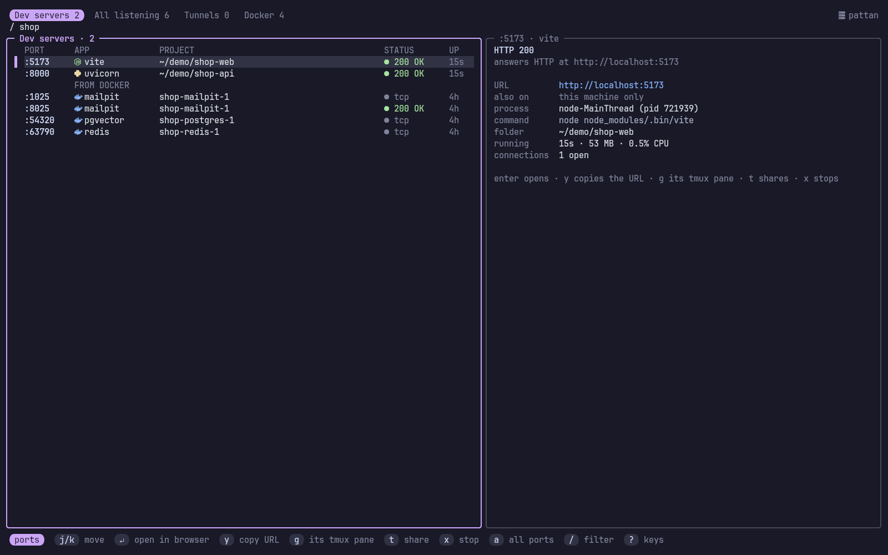

# pattan

<!-- identity -->
<p align="center">
  
</p>

<p align="center">
  <b>सर्वकर्माणि मनसा संन्यस्यास्ते सुखं वशी ।<br>
  नवद्वारे पुरे देही नैव कुर्वन्न कारयन् ॥</b><br>
  <i>Master of itself, the embodied one rests at ease in the city of nine gates.</i><br>
  <sub>Bhagavad Gītā 5.13</sub>
</p>
<!-- /identity -->

> *Pattan* (पत्तन) is Sanskrit for "port, harbour": where your connections come in.

**The ports your dev servers listen on, Docker's published ports, and the
tunnels that make them public, in the terminal.** Enter opens
`localhost:port` in the browser.

pattan (पत्तन) is Sanskrit for a harbour: where things come in and go out.

```
 Dev servers 5   All listening 13   Tunnels 1   Docker 4                    󰒋 pattan
╭─ Dev servers · 5 ───────────────────────────╮╭─ :5173 · vite ──────────────────────────╮
│ PORT     APP          PROJECT        STATUS  ││ OnAds · Dashboard                       │
│▌:5173 󰖟  vite         onads/apps/web ● 200 OK││                                         │
│ :4000    express      onads/apps/api ● 404   ││ URL        http://localhost:5173        │
│ :4321    astro        onads/apps/docs● 200 OK││ also on    http://192.168.1.12:5173     │
│          FROM DOCKER                         ││ process    node (pid 48211)             │
│ :5432    postgres     onads-postgres-1 ● tcp ││ tmux pane  main:2.1 · claude            │
╰──────────────────────────────────────────────╯╰─────────────────────────────────────────╯
 ports   j/k move   ↵ open in browser   y copy URL   g its tmux pane   t share   x stop
```

<p align="center">
  
</p>
<p align="center"><sub>Screenshots use made-up demo projects.</sub></p>

## What it shows

- **Dev servers**: the TCP ports your own processes listen on from inside
  a project folder (somewhere under your home, not a hidden folder), so
  daemons like KDE Connect or mpd stay out. Each with the app (vite, next,
  nest, astro, django, uvicorn, rails, hugo... read from the command line,
  then from the project's `package.json`), the project folder, whether it
  answers (HTTP status, or `tcp` for databases, which are never sent HTTP),
  and how long it has run. Docker's published ports follow, under *from
  docker*.
- The details pane: the page's `<title>`, the URL, the address other
  machines on your network can use (when it listens on more than
  loopback), the process and its command, the folder, the **tmux pane it
  runs in**, uptime, memory, CPU, open connections, and its public tunnel
  URL if it has one.
- **All listening**: every listening port on the machine, local or open to
  the network, with the process when it's yours to see.
- **Tunnels**: every tunnel running, with its public URL and the local
  server it points at:
  - **ngrok**: from its local API (`localhost:4040`): the public URL, the
    request count, and the **last requests**; `R` sends one again (handy
    for webhooks), `i` opens ngrok's inspector.
  - **cloudflared** quick tunnels: the `trycloudflare.com` URL, from its
    metrics server.
  - **tailscale serve / funnel**: what this machine serves, and whether
    it's public (funnel) or tailnet-only.
  - **ssh -R** forwards: the remote host and port.
  - **localtunnel**, **bore**, **zrok**: found by their process; the URL
    when their command line gives it.
- **Docker**: the ports containers publish.

`t` on a port starts a tunnel to it with any tool you have installed
(ngrok, cloudflared, tailscale funnel, localtunnel, bore). It runs on its
own, keeps running after pattan quits, and logs to
`~/.local/state/pattan/<tool>-<port>.log`.

Everything refreshes every 2 seconds; the HTTP check every 10.

## Keys

pattan uses the vim grammar every Vayu tool shares
([vyakarana](https://github.com/Theyashsawarkar/vyakarana)): in NORMAL,
keys are commands and typing changes nothing; `/` starts INSERT to filter
(`Esc` goes back and keeps the filter). `Space` is the leader: press it and
a box lists what can follow (`Space y` copies, `Space d` stops, `Space g`
goes to, `Space t` switches tabs...). `Space Space` searches every action,
`?` shows every key. Counts work (`5j`, `3gg`). Anything that stops a
server or a tunnel asks first, and only `y` says yes.

Keys that moved say where they went for one release: `t` → `Space a t`,
`T` → `Space g t`, `K` (force stop) → `Space d k`, `a` → `Space t a`, on a
tunnel `R` → `Space i r` and `i` → `Space i i`. `g` now starts `g g`; the
tmux pane is `Space g p`. Tabs are `H` / `L` (`Tab` and `h` / `l` too);
`1`–`4` are counts now, the tabs are `Space t 1`–`4`.

<!-- keys: generated from the keymap; run the tests with -update -->
**Everywhere**

| Keys | What it does |
|---|---|
| <kbd>j</kbd> or <kbd>Down</kbd> | Move to the next port |
| <kbd>k</kbd> or <kbd>Up</kbd> | Move to the previous port |
| <kbd>g</kbd> <kbd>g</kbd> or <kbd>Home</kbd> | Jump to the first port (5gg: the fifth) |
| <kbd>G</kbd> or <kbd>End</kbd> | Jump to the last port (5G: the fifth) |
| <kbd>Ctrl+d</kbd> or <kbd>PgDn</kbd> | Scroll half a page down |
| <kbd>Ctrl+u</kbd> or <kbd>PgUp</kbd> | Scroll half a page up |
| <kbd>L</kbd> or <kbd>Tab</kbd> | Switch to the next tab |
| <kbd>H</kbd> or <kbd>Shift+Tab</kbd> | Switch to the previous tab |
| <kbd>/</kbd> or <kbd>Space</kbd> <kbd>f</kbd> <kbd>f</kbd> | Search the list by port, app, project or URL (filters it) |
| <kbd>r</kbd> or <kbd>Space</kbd> <kbd>r</kbd> | Rescan the ports now (it also rescans every 2 s) |
| <kbd>?</kbd> or <kbd>Space</kbd> <kbd>?</kbd> | Show every key of this view |
| <kbd>q</kbd> or <kbd>Space</kbd> <kbd>q</kbd> | Quit |
| <kbd>Esc</kbd> | Go back one step: clear the filter, then quit |
| <kbd>Space</kbd> <kbd>Space</kbd> | Search every action and run one (the palette) |
| <kbd>Space</kbd> <kbd>t</kbd> | *Tabs…* |
| <kbd>Space</kbd> <kbd>t</kbd> <kbd>d</kbd> or <kbd>Space</kbd> <kbd>t</kbd> <kbd>1</kbd> | Switch to Dev servers |
| <kbd>Space</kbd> <kbd>t</kbd> <kbd>a</kbd> or <kbd>Space</kbd> <kbd>t</kbd> <kbd>2</kbd> | Switch to All listening (every port) |
| <kbd>Space</kbd> <kbd>t</kbd> <kbd>t</kbd> or <kbd>Space</kbd> <kbd>t</kbd> <kbd>3</kbd> | Switch to Tunnels |
| <kbd>Space</kbd> <kbd>t</kbd> <kbd>k</kbd> or <kbd>Space</kbd> <kbd>t</kbd> <kbd>4</kbd> | Switch to Docker |
| | *While typing* |
| <kbd>Esc</kbd> | Stop typing and keep the filter (back to NORMAL) |
| <kbd>Ctrl+j</kbd> or <kbd>Down</kbd> or <kbd>Ctrl+n</kbd> | Move to the next port while typing |
| <kbd>Ctrl+k</kbd> or <kbd>Up</kbd> or <kbd>Ctrl+p</kbd> | Move to the previous port while typing |

**On a port**

| Keys | What it does |
|---|---|
| <kbd>Enter</kbd> | Open localhost:port in the browser |
| <kbd>o</kbd> or <kbd>Space</kbd> <kbd>o</kbd> <kbd>b</kbd> | Open localhost:port in the browser |
| <kbd>y</kbd> or <kbd>Space</kbd> <kbd>y</kbd> <kbd>u</kbd> | Copy the URL |
| <kbd>Y</kbd> or <kbd>Space</kbd> <kbd>y</kbd> <kbd>l</kbd> | Copy the URL other machines on your network can use |
| <kbd>d</kbd> <kbd>d</kbd> or <kbd>x</kbd> or <kbd>Space</kbd> <kbd>d</kbd> <kbd>s</kbd> | Stop the server (asks first; a container is stopped with docker stop) |
| <kbd>Space</kbd> <kbd>a</kbd> | *Add…* |
| <kbd>Space</kbd> <kbd>a</kbd> <kbd>t</kbd> | Start a tunnel to the port, to share it (ngrok, cloudflared, tailscale funnel...) |
| <kbd>Space</kbd> <kbd>d</kbd> | *Delete…* |
| <kbd>Space</kbd> <kbd>d</kbd> <kbd>k</kbd> | Kill the server at once (SIGKILL; asks first) |
| <kbd>Space</kbd> <kbd>d</kbd> <kbd>t</kbd> | Stop the port's tunnel (asks first) |
| <kbd>Space</kbd> <kbd>g</kbd> | *Go to…* |
| <kbd>Space</kbd> <kbd>g</kbd> <kbd>p</kbd> | Go to the tmux pane the server runs in |
| <kbd>Space</kbd> <kbd>g</kbd> <kbd>t</kbd> | Go to the port's tunnel in the Tunnels tab |
| <kbd>Space</kbd> <kbd>y</kbd> | *Copy…* |
| <kbd>Space</kbd> <kbd>y</kbd> <kbd>p</kbd> | Copy the public URL of the port's tunnel |

**On a tunnel**

| Keys | What it does |
|---|---|
| <kbd>Enter</kbd> or <kbd>Space</kbd> <kbd>o</kbd> <kbd>b</kbd> | Open the tunnel's public URL in the browser |
| <kbd>o</kbd> or <kbd>Space</kbd> <kbd>o</kbd> <kbd>l</kbd> | Open the local server the tunnel points at |
| <kbd>y</kbd> or <kbd>Space</kbd> <kbd>y</kbd> <kbd>p</kbd> | Copy the public URL |
| <kbd>J</kbd> | Move to the next of the tunnel's last requests (ngrok) |
| <kbd>K</kbd> | Move to the previous of the tunnel's last requests (ngrok) |
| <kbd>d</kbd> <kbd>d</kbd> or <kbd>x</kbd> or <kbd>Space</kbd> <kbd>d</kbd> <kbd>t</kbd> | Stop the tunnel (asks first) |
| <kbd>Space</kbd> <kbd>i</kbd> | *Inspect…* |
| <kbd>Space</kbd> <kbd>i</kbd> <kbd>r</kbd> | Send the selected request through the tunnel again (ngrok replay) |
| <kbd>Space</kbd> <kbd>i</kbd> <kbd>i</kbd> | Open ngrok's request inspector in the browser |
| <kbd>Space</kbd> <kbd>y</kbd> | *Copy…* |
| <kbd>Space</kbd> <kbd>y</kbd> <kbd>u</kbd> | Copy the local URL the tunnel points at |
<!-- /keys -->

## Install

Needs Linux with `ss` (iproute2). Docker, tmux and the tunnel tools are
optional: pattan uses what's there.

```sh
curl -fsSL https://raw.githubusercontent.com/Theyashsawarkar/pattan/main/install.sh | bash
```

downloads the release binary (or builds it with Go) into
`~/.local/share/pattan` and links `~/.local/bin/pattan`. Or `make install`
(`PREFIX`, `DESTDIR`), or `go install github.com/Theyashsawarkar/pattan/cmd/pattan@latest`.

### As a tmux plugin

```tmux
set -g @plugin 'Theyashsawarkar/pattan'
```

`prefix P` opens pattan in a popup; `P` inside closes it. Without pattan on
your `PATH`, the plugin builds it with Go the first time.

| Option | Default | |
|---|---|---|
| `@pattan-key` | `P` | the key after the prefix; `none` binds nothing |
| `@pattan-width` / `@pattan-height` | `90%` / `88%` | popup size |
| `@pattan-title` | ` pattan ` | popup title |
| `@pattan-launcher` | | your own popup command instead of `display-popup`; it gets display-popup's arguments (`-E -d DIR -T TITLE CMD`) |

To open it from a status-line click, open a popup that runs
`~/.tmux/plugins/pattan/scripts/pattan-run --client '#{client_name}'`.

## Command line

```
pattan                 the screen
pattan list            the dev servers' ports: "5173 vite onads-super/apps/web"
pattan list --all      every listening port
pattan tunnels         the tunnels: "ngrok https://… -> :5173"
pattan --version
```

## Colours

pattan follows [varna](https://github.com/Theyashsawarkar/varna)'s desktop
theme (`~/.local/state/varna/palette.json`, a `tools.pattan` pick if the
theme has one) and changes live with it; without varna it is Catppuccin
Mocha. Icons need a Nerd Font; `NO_NERD_FONT=1` turns them off.

## Privacy

pattan reads `/proc` and `ss`, asks your own ports over localhost, and
talks to ngrok's and cloudflared's local APIs. Nothing leaves the machine
unless you start a tunnel, which makes that one port public.

## License

MIT
